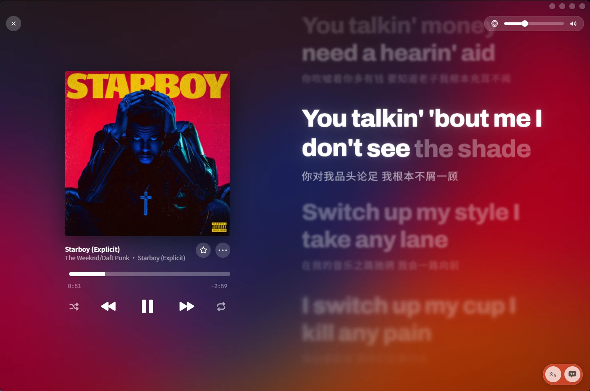

<p align="center"></p>

# Lumilyric

桌面歌词：跟着电脑上正在播放的音乐，自动找到逐字歌词和封面，把歌词做成好看的动态效果显示出来。在 QQ 音乐、Spotify 等播放器里放歌，它会识别是哪首歌、跟上进度，让歌词随着歌声逐词点亮、滚动、发光。

- 逐词 / 逐字高亮，滚动歌词、单句、逐词三种布局，以及仿 Apple Music 全屏播放的 AM 布局
- 流光背景、辉光、封面显示，支持会动的动态封面
- 也可以自己载入歌词（`.lrc` / `.ttml`）和音频，导出歌词视频：MP4（可带原曲音频）、透明 MOV 或 PNG 序列



## 快速开始

需要 Windows 10 或 11。

1. 到 [Releases](https://github.com/ZBZD-p/Lumilyric/releases/latest) 下载最新的桌面版压缩包（`Lumilyric-v…-windows.zip`）。
2. 解压到一个能写入的位置（不要放 `C:\Program Files`），双击里面的 **`Lumilyric.exe`**。不需要安装 Python 或别的东西。
3. 在音乐播放器里放一首歌，点底栏右端的「⋯」，打开里面的「跟随播放器」，歌词和封面会自动出现。各播放器能支持到什么程度见下面的[跟随播放器](#跟随播放器)。
4. 没有播放器也能用：「⋯ → 载入歌词」选一个 `.lrc` / `.ttml`，或者在「歌词库」里搜，再按需载入音频。

桌面版的更多说明见[桌面版](#桌面版)。它不带自动识别和逐字对齐这两个很大的功能，要用它们或者想改代码，见[从源码运行](#从源码运行)。

## 界面和效果

都在「⋯ → 效果设置」里，改动会直接显示在歌词上，导出视频也用同一套设置（除非下面另有说明）。

- **歌词布局**：单句、滚动歌词、逐词三种；语言可以在「English」和「双语」之间切换。
- **AM 布局**：仿 Apple Music 的全屏播放界面。封面在左，歌名、进度条和播放按钮在封面下面，歌词在右。右下角两个按钮分别是显示 / 隐藏译文和显示 / 隐藏歌词（隐藏歌词后封面移到正中）；左上角的 × 退出。随机、循环、收藏、隔空播放这几个按钮目前只是占位。窗口竖着的时候仍用原来的布局。
- **动态封面**：封面可以是一段循环播放的短视频。
  - 「选图片」可以选本地的 MP4 / WebM / GIF。
  - 「搜封面」里 Apple Music 的结果带「动态」角标的，点了会下载那张专辑的动态封面（十几 MB，下过一次就存在本地）。
  - 跟随播放器时，正在放的歌所在的专辑有动态封面就自动换上；找不到同一版本时，会用同一歌手、同名专辑的另一个版本。
  - 打开「背景跟随动态封面」后，「封面流动」背景会跟着封面当前的画面变色，旁边的「响应时间」调跟随的快慢。
  - 导出的视频里封面和背景仍是静态的一帧。
- **背景**：纯黑、封面流动、主色光斑。封面几乎是纯色时，会自动补一些明暗层次，不至于整屏一个颜色。
- **律动**：背景跟着低音动。「低音范围」调多低的声音才算低音，「触发强度」调低音多强才开始动。
- **辉光**：风格、强度、范围、阈值、颜色；一句的最后一个词拖长音时会更亮一些，「长音增亮」调亮多少，「触发时长」调唱多久才触发。
- **性能显示**：帧数、最慢一帧、渲染方式、分辨率和显卡；「精简显示」只留帧数和最慢一帧。

## 跟随播放器

在电脑上的音乐播放器里放歌，Lumilyric 自动识别正在播放的歌、下载逐字歌词，并跟着播放器的进度走（暂停、拖动、切歌都会跟上）。只在 Windows 10/11 上可用。

- 打开方式：「⋯」菜单里的「跟随播放器」。有多个播放器同时在跑时，旁边会多出一个下拉框选择跟随哪一个。
- 优先跟随音乐播放器，即使它是暂停的而别的程序正在播放。
- 浏览器里播放的声音和视频不跟随，也不出现在下拉框里。
- 播放器接受跳转时（如 Spotify），拖页面的进度条会让它一起跳到那个位置；不接受的（如 QQ 音乐），进度条锁住。各播放器的区别见下面[各播放器的支持程度](#各播放器的支持程度)。
- 歌词和播放器有固定延迟时，用「歌词偏移」修正；偏移按播放器分别记住。

### 各播放器的支持程度

区别主要在两点：播放器肯不肯把**播放进度**交给系统，以及肯不肯接受从外部**跳转**。能报进度的，歌词一直和歌对齐；不报进度的，只能从切歌那刻起自己计时，中途暂停续播、或在播放器里拖过进度条，就需要手动校准。能接受跳转的（如 Spotify），在页面上拖进度条会让播放器一起跳到那个位置；不接受的（如 QQ 音乐），进度条是锁住的。

| 播放器 | 支持程度 | 播放进度 | 页面拖进度 | 说明 |
| --- | --- | --- | --- | --- |
| QQ 音乐 | 完整 | 有，随播放更新 | 不支持 | 歌名、歌手、专辑都有，封面 300×300。它不接受外部跳转，所以进度条锁住；切歌时进度和时长会晚一点才更新（已处理） |
| Spotify | 完整 | 有 | 同步到播放器 | 能读到进度，歌词自动对齐；拖页面进度条会让 Spotify 一起跳过去 |
| 网易云音乐 | 部分 | 没有 | 仅校准歌词 | 有歌名和歌手，没有专辑，封面 135×135。自己计时，拖进度条只对齐歌词显示，不影响播放器 |
| 酷狗音乐 | 部分 | 没有 | 仅校准歌词 | 有歌名和歌手，没有专辑，封面 120×120。同网易云 |
| 酷我音乐、Apple Music | 还没测试 | 未知 | 未知 | 会被当作音乐播放器优先跟随，但能读到什么、接不接受跳转都还没有实际验证 |
| 其他播放器 | 不保证 | 未知 | 未知 | 能不能拖进度取决于它向系统声明接不接受跳转；有的播放器不接入系统媒体会话，或者只在暂停 / 拖动时才更新进度 |
| 浏览器（Chrome、Edge、Firefox 等） | 不跟随 | — | — | 网页里的音乐和视频都不跟随 |

想确认自己的播放器能不能被识别：从源码运行时可以执行 `scripts\probe_nowplaying.bat`，它每 0.5 秒打印一次系统里所有媒体会话（原始值同时写进 `tools\nowplaying-probe.log`）。

原理：读取 Windows 的系统媒体会话（和音量弹出框里显示的“正在播放”是同一份数据），不会注入或修改播放器。

背景律动：跟随时没有音频文件可分析，改为抓取电脑正在播放的声音，只计算低频响度这一个数值（不保存、不上传任何音频）。抓的是整个系统输出，浏览器、通知音也会混进去。（从源码运行时，它需要 `setup_nowplaying.bat` 里一并安装的 PyAudioWPatch，约 100 KB。）

缓存：找到的歌词、选定的高清封面和下载过的动态封面会存在 `tools\cache`（同一首歌第二次放几乎是立刻出现，不用再联网），总大小上限默认 300 MB（环境变量 `LRC_CACHE_MB` 可改），超出时先删最久没用的。一个动态封面有十几 MB，经常用的话可以把上限调大。想清空就直接删这个文件夹。

## 从源码运行

要用自动识别、逐字对齐，或者想改代码时用这种方式；页面在浏览器里打开。

1. 第一次使用：双击 `scripts\setup_base.bat`，创建 Python 环境（只有 numpy，约 60 MB，只需一次）。
2. 双击 **`start_server.bat`**，浏览器会自动打开 `http://127.0.0.1:8765/`。用页面期间保持这个黑色窗口开着。
3. 跟随播放器需要再装两样（各只需一次）：`scripts\setup_nowplaying.bat` 和 `scripts\setup_lddc.bat`，装完重新打开 `start_server.bat`。
4. 其他可选功能见[基础安装和可选扩展](#基础安装和可选扩展)。

只想播放和导出、不需要识别对齐和跟随播放器：运行 `python scripts/build_single.py`，得到单文件版 `dist/lumilyric.html`，双击就能打开。

## 文件夹

```
lumilyric/
├─ start_server.bat      启动本地程序并打开页面（日常只需要它）
├─ web/                  页面
│  ├─ index.html         页面结构
│  ├─ style.css          样式
│  ├─ js/                代码（ES module），按功能分子目录（见下表）
│  └─ vendor/            第三方库：mp4-muxer（MIT）
├─ server/               本地程序（Python）
│  ├─ server.py          本地服务：提供页面、识别、对齐、歌词搜索、封面搜索
│  ├─ align_lrc.py       wav2vec2 逐字强制对齐（中文 / 英文）
│  ├─ lddc_bridge.py     QQ 音乐 / 酷狗 / 网易云 逐字歌词（通过 LDDC）
│  ├─ qt_stub/           PySide6（Qt，215 MB）的替身：LDDC 搜词只用到几个名字，用纯 Python 顶替（有测试）
│  ├─ cover_search.py    专辑封面搜索、Apple Music 动态封面
│  ├─ nowplaying.py      跟随播放器：读取系统媒体会话、快照、控制
│  ├─ track_state.py     切歌后什么时候播放器的进度/时长可信（纯逻辑，有测试）
│  ├─ lyrics_match.py    给正在播放的歌挑歌词、打分（纯逻辑，有测试）
│  ├─ disk_cache.py      歌词、高清封面和动态封面的磁盘缓存（tools\cache，有测试）
│  └─ audio_level.py     跟随播放器：抓取系统声音的低频响度（背景律动）
├─ desktop/
│  ├─ app.py             桌面版：启动本地服务并打开 WebView2 窗口
│  ├─ launcher.cs        Lumilyric.exe 的源码（只负责无黑窗口地启动 app.py）
│  └─ build.py           打包：自带 Python、依赖库、页面和服务
├─ scripts/
│  ├─ setup_base.bat     一次性安装：Python 环境（tools\align-env，只有 numpy）
│  ├─ setup_align.bat    可选扩展：逐字对齐（torch、transformers）
│  ├─ setup_whisper.bat  可选扩展：自动识别（whisper.cpp 和模型）
│  ├─ setup_lddc.bat     一次性安装：LDDC 歌词库
│  ├─ setup_nowplaying.bat  一次性安装：跟随播放器需要的系统媒体会话库
│  ├─ probe_nowplaying.bat  探测：列出系统里所有正在播放的媒体会话
│  ├─ transcribe.bat     命令行识别：把音频拖上去，生成 Whisper JSON
│  ├─ align.bat          命令行对齐：把音频和 .lrc 一起拖上去
│  ├─ build_single.py    生成单文件版页面 dist/lumilyric.html
│  ├─ build_desktop.bat  生成桌面版 dist\Lumilyric（见「桌面版」）
│  └─ tidy_old_files.bat 旧版文件夹整理（只需运行一次）
├─ tests/                测试：python tests/test_track_state.py、tests/test_lyrics_match.py、tests/test_disk_cache.py、tests/test_qt_stub.py、tests/test_audio_level.py；node tests/test_transition.js、tests/test_seek.js、tests/test_intro_dots.js、tests/test_look_melt.js、tests/test_seg_thumb.js、tests/test_smooth_scroll.js、tests/test_tooltip.js、tests/test_letter_lift.js、tests/test_glide.js
├─ models/               Whisper 模型（ggml-*.bin），不进仓库
├─ tools/                whisper.cpp、Python 环境、模型缓存、临时文件，不进仓库
└─ examples/             示例歌词
```

### web/js 各文件

页面的代码是一组 ES module：`index.html` 只加载 `js/app.js`，它按下面的顺序列出所有文件。每个文件用 `import` 写明自己要用谁的东西，**只会引用顺序在它之前的文件**；需要后面文件里的名字时（比如 `settings.js` 要调用 `follow.js` 的函数），后面的文件在加载完时把它放进 `core/late.js` 的 `late` 对象，前面的文件在运行时用 `late.名字` 调用。这样文件始终严格按 `app.js` 里的顺序运行。

被别的文件赋值的共享变量（`cur`、`mode`、`fx` 等）由定义它的文件导出一个 `setXxx()` 函数，别的文件用它来改（模块里不能给导入的名字赋值）。

| 目录 / 文件 | 内容 |
| --- | --- |
| `app.js` | 入口：按顺序列出所有文件 |
| `core/core.js` | 示例歌词、共享状态、LRC 解析 |
| `core/lyrics.js` | TTML、Whisper 逐词对齐、逐词 LRC 读写 |
| `core/settings.js` | 效果设置（`fx`）、离场预设、逐字高亮时间、辉光 |
| `core/sync.js` | 歌词时间偏移输入 |
| `core/late.js` | 前向引用：后加载的文件把名字放在这里，先加载的文件用 `late.名字` 调用 |
| `render/view-dom.js` | 单句布局：长句拆分、网页渲染 |
| `render/text-canvas.js` | 画布文字：缓动、高亮扫光、文字缓存、单句画布渲染 |
| `render/bloom.js` | WebGL 辉光 |
| `render/song-transition.js` | 滚动歌词切歌：旧的拖出、新的拖入（纯逻辑，有测试） |
| `render/seek-motion.js` | 滚动歌词跳转进度：点击拖出拖入、按住拖动跟手、小跳转滑动（纯逻辑，有测试） |
| `render/intro-dots.js` | 滚动歌词前奏的三个小点：依次点亮、呼吸、结束前缩小消失（纯逻辑，有测试） |
| `render/layout-scroll.js` | 滚动歌词布局 |
| `render/layout-words.js` | 逐词布局和它的动画预设 |
| `render/smooth-scroll.js` | 滚轮平滑滚动（有测试） |
| `render/frame.js` | 封面面板、AM 布局的位置、整帧合成（`drawFrame`） |
| `background/background.js` | 流光背景、节拍跳动、画布实时显示 |
| `background/look-melt.js` | 背景外观渐变：换歌和切换背景样式时混色（纯逻辑，有测试） |
| `background/cover-extract.js` | 读取音频文件里的封面、设置封面（图片或动态封面的视频） |
| `glass/glass.js` | 液态玻璃界面：WebGL 实时绘制折射和边缘高光 |
| `glass/seg-thumb.js`、`glass-toggle.js`、`glass-slider.js` | 分段开关、开关、滑块上的玻璃滑块 |
| `export/export.js` | 导出 MP4 / MOV / PNG ZIP、音频、保存位置 |
| `ui/ui-effects.js` | 效果设置面板、封面搜索 |
| `ui/fonts.js` | 歌词字体设置：中文 / 英文字体、加粗、字号，歌词和译文各一组 |
| `ui/dropdown.js`、`tooltip.js`、`menu.js`、`desktop.js` | 下拉框、悬停提示、「更多」菜单、桌面版窗口按钮 |
| `ui/am.js` | AM 布局四周的按钮：退出、音量、译文和歌词开关，以及占位按钮 |
| `player/library.js` | 歌词库：AMLL TTML DB、LDDC |
| `player/follow.js` | 跟随播放器：轮询、时间平滑、切歌找歌词和封面 |
| `player/helper.js` | 页面里的自动识别 / 对齐 |
| `main.js` | 性能显示、主循环、播放控制、载入文件、快捷键 |

单文件版（`scripts/build_single.py`）把这些模块按浏览器会运行的顺序拼成一个普通脚本，所以所有文件的顶层名字必须互不相同，构建时会检查。

## 桌面版

不用浏览器、不用自己装 Python 的版本：一个文件夹，双击 `Lumilyric.exe` 就是一个独立窗口，没有黑色命令行窗口。

- 生成：先关掉正在运行的桌面版，再双击 `scripts\build_desktop.bat`（要先有 `tools\align-env`）。重新生成不会清掉它的 `tools\`（缓存和设置）。结果在 `dist\Lumilyric\`，同时打一个 `dist\Lumilyric.zip`。实测文件夹约 33 MB，压缩包约 15 MB。
- 给别人用：把压缩包发过去，解压到一个能写入的位置（不要放 `C:\Program Files`），双击 `Lumilyric.exe`。对方电脑不需要 Python。
- 窗口没有标题栏，页面铺满整个窗口：最上面一条（24 像素）可以拖动窗口、双击最大化，右上角四个小圆点是页面自己画的全屏 / 最小化 / 最大化 / 关闭，四条边照常缩放。全屏（盖住任务栏）：F11 或第一个圆点，F11 或 Esc 退出。
- 窗口用的是 Windows 自带的 WebView2（就是 Edge 的内核），页面在里面和在 Edge 里一样走显卡。电脑上没有 WebView2 时改用 Edge 的应用窗口，再没有就用默认浏览器，这两种情况会多一个小对话框，关掉它就是退出。
- 带的功能：页面本身、导出、歌词库和 QQ / 酷狗 / 网易云搜词、封面搜索、跟随播放器（含律动）。**没有带**自动识别和逐字对齐（1 GB 以上），要用时仍然用项目文件夹里的 `start_server.bat`。
- 运行时产生的东西都在它自己的 `tools\` 里：`cache\`（歌词和封面缓存）、`desktop.log`（原来黑窗口里显示的内容，出问题时看它）、`window.json`（窗口大小位置）、`webview\`（页面保存的设置）。删掉整个文件夹就是卸载。
- 页面的设置和浏览器版是分开保存的（两边不是同一个浏览器配置）。
- 体积小的原因：不带 Qt（LDDC 的界面库，215 MB，用 `server\qt_stub` 顶替）、不带 numpy（律动的滤波改成了纯 Python）、不带浏览器内核（用系统的）。
- LDDC 是 GPL-3.0，所以把这个压缩包发给别人时，整体要按 GPL-3.0 提供（附源码）。自己用不受影响。

## 基础安装和可选扩展

基础安装（`setup_base.bat`）只有几十 MB，就够用：页面、歌词库、导出视频、跟随播放器。更重的功能是**可选扩展**，要用再装，不用就不占空间：

| 扩展 | 安装脚本 | 大小 | 用来做什么 |
| --- | --- | --- | --- |
| 跟随播放器 | `setup_nowplaying.bat` | 几 MB | 读取电脑上正在播放的歌（QQ 音乐、网易云、酷狗等） |
| QQ / 酷狗 / 网易云歌词搜索 | `setup_lddc.bat` | 约 10 MB | 歌词库里搜逐字歌词；跟随播放器自动找歌词也靠它 |
| 自动识别（Whisper） | `setup_whisper.bat` | 0.6 到 1.7 GB | 没有歌词时，从音频识别出歌词。脚本里选 GPU（约 670 MB）或 CPU（21 MB）版，再选模型（turbo 574 MB / large-v3 1.08 GB） |
| 逐字对齐 | `setup_align.bat` | 约 1 GB + 模型 | 把 LRC 逐字对齐到音频。对齐模型第一次用时才下载：中文 1.2 GB、英文 360 MB |

没装的扩展，页面里的「自动识别」窗口会把对应选项置灰，并写明运行哪个脚本；装完后关掉 `start_server.bat` 的黑窗口再打开即可。

## 本地识别与对齐

- **识别**（没有歌词时）：whisper.cpp，有 NVIDIA 显卡时用 CUDA 版。由 `setup_whisper.bat` 下载程序和模型；模型文件放在 `models\`，也可以自己放别的 ggml 模型（认 `ggml-large-v3-q5_0.bin`、`ggml-large-v3.bin`、`ggml-large-v2-q5_0.bin`、`ggml-large-v3-turbo-q5_0.bin`）。
- **逐字对齐**（已有歌词时）：wav2vec2 强制对齐，中文、英文各自用对应的模型，第一次使用时自动下载到 `tools\hf-cache`。
- **歌词库**：AMLL TTML DB（社区逐词歌词，有些歌带伴唱）。跟随播放器时会先查它，有这首歌就用，没有再用 QQ 音乐 / 酷狗 / 网易云（需要先运行 `scripts\setup_lddc.bat`，装好后歌词库窗口里也能搜这三家）。
- 本地程序只监听本机 `127.0.0.1`，上传的音频临时放在 `tools\server-tmp`，下次启动时清空。

## 导出

MP4（H.264，可带 AAC 音频）、透明背景 MOV（PNG 编码）、PNG 序列 ZIP。可选尺寸、帧率、画质 / 防色带、编码速度和保存位置；导出时显示每帧耗时分析。

## 第三方

- [mp4-muxer](https://github.com/Vanilagy/mp4-muxer)（MIT），见 `web/vendor/mp4-muxer.LICENSE.txt`
- [whisper.cpp](https://github.com/ggerganov/whisper.cpp)（MIT），单独下载
- [LDDC](https://github.com/chenmozhijin/LDDC)（GPL-3.0），由 `setup_lddc.bat` 单独安装
- 字体：Archivo、Noto Sans SC、JetBrains Mono（SIL Open Font License 1.1）。字体文件放在 `web/fonts/`（来自 npm 的 @fontsource 包，即 Google Fonts 发布的版本），各自的许可证文本也在那个文件夹里（`*-OFL.txt`）。页面不再从网络加载字体，断网也能正常显示；单文件版只内置 Archivo 和 JetBrains Mono，中文用系统自带的中文字体。

## 许可证

Copyright (C) 2026 ZBZD-p

本项目以 [GNU General Public License v3.0](LICENSE)（GPL-3.0）发布：可以使用、修改和再发布（包括商用），但再发布的版本，包括修改后的版本，必须同样以 GPL-3.0 开源并附上源码。

## 免责声明

- 本项目仅供个人学习和研究使用。
- 「歌词库」「封面搜索」「跟随播放器」会访问第三方服务（AMLL TTML DB、QQ 音乐 / 酷狗 / 网易云、Apple Music 等）或读取本机播放器的信息，这些接口不是官方提供的公开 API，随时可能变化或失效，也不保证可用。其中 Apple Music 的动态封面用的是它网页播放器自己读取的接口，失效时只是搜不到「动态」角标，其余功能不受影响。使用时请遵守这些服务各自的条款。
- 歌词和专辑封面（包括动态封面）的版权属于原作者和权利人。除了 README 里用来演示界面的截图（其中出现的封面和歌词片段只为展示软件的样子），本仓库不包含任何受版权保护的歌词、音乐或封面；缓存只保存在你自己的电脑上（`tools\cache`）。
